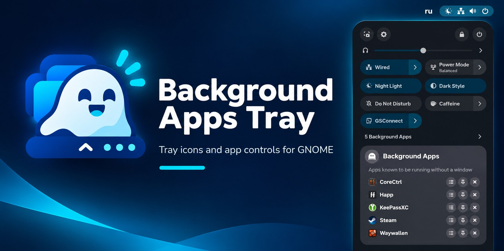
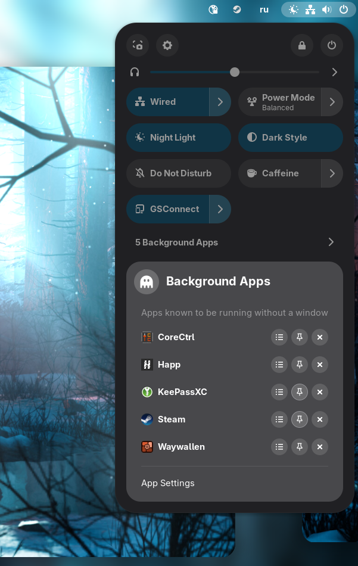
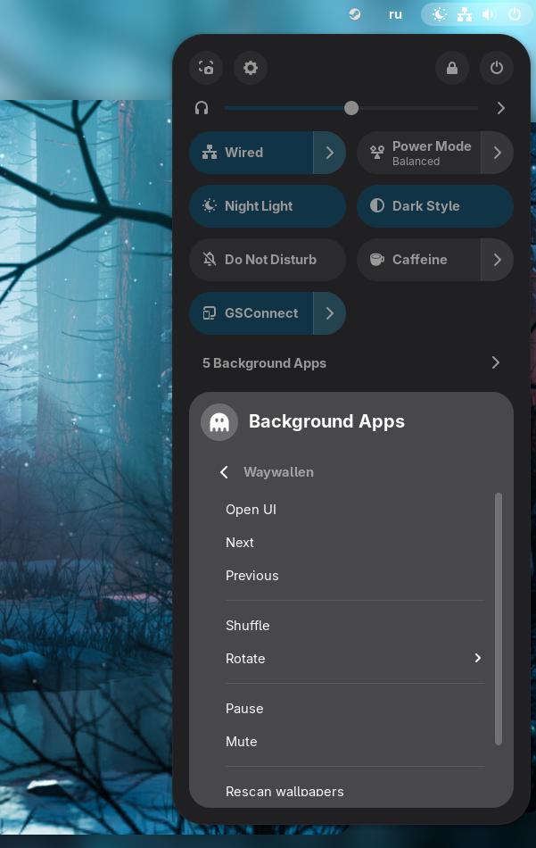

<div align="center">


# Background Apps Tray

### Your background apps, right where you need them.

Bring tray menus, panel icons, and app controls into GNOME's Quick Settings.




**See what's running. Open its menu. Pin it to your panel.**

</div>

## Make background apps feel at home in GNOME

Some apps keep running after their windows close. Background Apps Tray brings their controls into GNOME's existing **Quick Settings → Background Apps** section, so you can find and manage them without hunting for a window.

- **Open app menus** directly from the background apps list or a pinned panel icon.
- **Pin your favorites** to the top panel. Pins are remembered across app launches and GNOME sessions.
- **Quit background apps** from the same place when a quit action is available.
- **Make the panel yours** with custom images and monochrome icons, globally or per app.
- **Keep GNOME's look and feel** by using its built-in Background Apps section.

<table>
  <tr>
    <td align="center"><br><strong>Pin apps to the panel</strong></td>
    <td align="center"><br><strong>Use application menus</strong></td>
  </tr>
</table>

## Requirements

- Linux with **GNOME Shell 45–51**. Check your version with `gnome-shell --version`.
- Disable **AppIndicator and KStatusNotifierItem Support** or **Ubuntu AppIndicators** if enabled. They use the same StatusNotifierWatcher as this extension.

## Install

Download `background-apps-tray@local.shell-extension.zip` from the [latest release](https://github.com/Gimas-aza/background-apps-tray/releases/latest), then run the following command in the download directory:

```sh
gnome-extensions install ./background-apps-tray@local.shell-extension.zip
```

Log out and back into GNOME, then enable the extension:

```sh
gnome-extensions enable background-apps-tray@local
```

Start an app with its tray icon enabled, then open **Quick Settings → Background Apps**.

### Build from source

You need `zip`, `msgfmt`, and `glib-compile-schemas` installed.

```sh
git clone https://github.com/Gimas-aza/background-apps-tray.git
cd background-apps-tray

glib-compile-schemas --strict schemas
mkdir -p locale/ru/LC_MESSAGES
msgfmt --check -o locale/ru/LC_MESSAGES/background-apps-tray.mo po/ru.po
zip -r ../background-apps-tray@local.shell-extension.zip \
    metadata.json *.js stylesheet.css icons schemas locale po vendor README.md AUTHORS.md LICENSE

gnome-extensions install ../background-apps-tray@local.shell-extension.zip
```

After installation, log out and back in, then enable the extension as shown above.

## How to use it

Each app can have up to three controls:

| Control | Action |
| --- | --- |
| **List** | Open the app's tray menu. If it does not provide one, the extension can show actions from its desktop file and an available quit command. |
| **Pin** | Add or remove its icon on the top panel. Clicking the pinned icon opens the same app menu. |
| **×** | Ask the app to quit, or stop its associated process or user process group. |

Click an app's name to open it when GNOME knows its desktop file. Controls appear only when the corresponding action is available.

## Customize panel icons

Open **Background Apps Tray** in the Extensions app, or run:

```sh
gnome-extensions prefs background-apps-tray@local
```

Choose a custom image, restore the default icon, or make an individual icon monochrome. You can also make all pinned icons monochrome. These settings apply only to icons pinned by this extension; custom image files must remain at their original paths.

## Which apps appear?

The list includes apps reported by GNOME's background portal, active AppIndicator / KStatusNotifierItem icons, and XEmbed icons when X11 or XWayland is available. Pinned apps also appear while running.

Apps without a tray icon or portal entry can be detected through systemd after their last normal window closes. The extension must have seen at least one window from the app; minimized windows count as open. Detection runs every four seconds and when the menu opens. The entry disappears when a window reopens.

XEmbed apps draw their own menus and control their position and closing behavior. The extension requests the menu at the bottom of the button and requests that it close when clicking outside the recognized menu and its submenus. When a process must be stopped with SIGTERM, the extension checks its PID and start time again and signals only one process owned by the current user.

## Credits and license

This project includes adapted code from [AppIndicator and KStatusNotifierItem Support v66](https://github.com/ubuntu/gnome-shell-extension-appindicator/tree/v66). See [AUTHORS.md](AUTHORS.md) for attribution and [LICENSE](LICENSE) for the GNU General Public License, version 2 or later.
